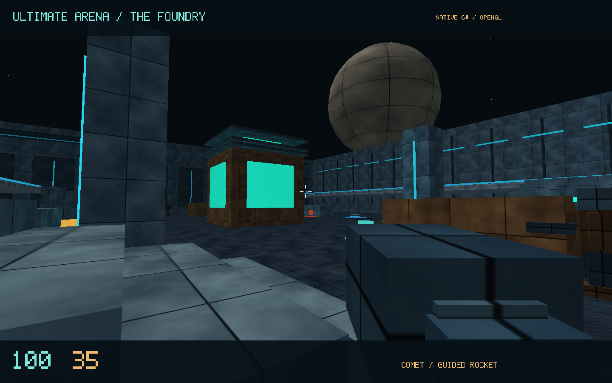
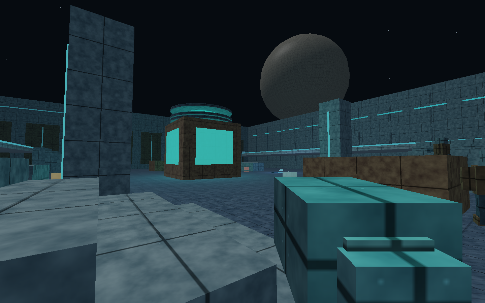

# Ultimate Arena — The Foundry

**A fast, arena-based first-person shooter prototype with six original weapons, bot opponents, and multiplayer.**

**Two playable editions:** a standalone Windows C# application and a browser/WebGL game with a Node.js host. They share the *Foundry* arena concept, but are **independent implementations with different network protocols**—you cannot join a Windows-edition match from the browser edition or vice versa.

> **Release status: prototype.** This is a playable vertical slice, not a feature-complete commercial game. Windows graphics and input still need testing on actual Windows hardware; network loopback tests do not establish internet play quality.



*Native Windows-edition renderer capture from an offscreen OpenGL QA run; not a screenshot of a complete Windows gameplay session.*

## Download and play

Find the two release downloads on the repository's **Releases** page. Extract the **entire ZIP**, then follow the instructions for your edition:

| Edition | Requirements | How to start | Multiplayer | 
| --- | --- | --- | --- |
| **Windows x64 portable** | Windows x64; OpenGL-compatible graphics | Double-click `UltimateArena.exe` | UDP port **27960**; in-game Host / Join controls |
| **Browser / server** | Node.js **22+**, modern WebGL 2 desktop browser | Double-click `Start-Arena.cmd` on Windows, or run `node server.js` inside the extracted folder | WebSocket over HTTP on TCP port **8080**; browser **Join Host** |

The Windows package includes its own .NET runtime: **no .NET installation required**. Do not separate its `.exe` from the accompanying `.dll` files. The browser package needs Node.js, but **no `npm install` and no ROMs**.

For browser LAN hosting, run `Host-LAN.cmd` or `node server.js --bind 0.0.0.0`, and have players navigate to `http://HOST-IP:8080/` and select **Join Host**. For native Windows LAN games, enter the host's LAN IPv4 address and UDP port, e.g. `192.168.1.50:27960`.

See [Windows guide](desktop/README.md) and [browser guide](browser/README.md) for detailed usage. Internet hosting, port forwarding, and firewall rules are the host's responsibility; automatic matchmaking and NAT traversal are not provided.

## In the arena

- One **48 × 48 m industrial arena**, with a central reactor, cover lanes, elevated galleries, stairs, and jump pads.
- **Six weapons**, each with a primary and alternate function: Kestrel, Tempest, Breacher, Longbow, Comet, and Latch.
- **Five bots** in solo practice, with route navigation, targeting, strafing, and range-based weapon choices.
- **Free-for-all deathmatch**: 20 frags or eight minutes per round, with respawns and score tracking.
- Health, armor, ammo pickups, generated materials, stylized first-person rendering, synthesized weapon effects, and scoreboard/kill feed.
- Multiplayer with an authoritative match host and client movement prediction in each edition, using their **own** protocols.

| Input | Action |
| --- | --- |
| `WASD` / mouse | Move / look |
| `Space` | Jump |
| `Shift` | Dodge |
| `Ctrl` | Steady aim (slower movement, better accuracy; not a full crouch) |
| `1`–`6` or mouse wheel | Switch weapon |
| Left / right mouse | Primary / alternate fire |
| `Tab` | Scoreboard |
| `Esc` | Menu / release mouse |
| `F` | Fullscreen (Windows also supports `F11`) |

### Weapon lineup

| Weapon | Primary | Alternate |
| --- | --- | --- |
| **Kestrel** | Precision sidearm | Focused shot |
| **Tempest** | High-rate carbine | Faster, wider burst |
| **Breacher** | Nine-pellet shotgun | Tighter sixteen-pellet volley |
| **Longbow** | Precision rail shot | Hold to zoom |
| **Comet** | Rocket | Guided rocket |
| **Latch** | Timed, bouncing explosive | Sticky proximity explosive |

<details>
<summary>Browser edition — renderer preview</summary>



*WebGL drawing commands replayed in an offscreen validation environment, rather than a screenshot of the fully running browser interface.*

</details>

## Project layout

```text
browser/       Browser/WebGL + Node.js edition (source, assets, tests, toolchain)
desktop/       Native C#/.NET 8 Windows edition (source, project, tests)
docs/images/   Validated offscreen renderer preview images
.github/       CI and issue templates
```

The **GitHub repository is source-first**. Ready-to-play Windows and browser distributions are **separate release assets**; build output and Microsoft runtime files do not belong in the Git history.

## Building and testing

**Browser edition** (Node.js 22+; no third-party npm packages):

```sh
cd browser
npm test
node server.js
```

**Windows edition source** (.NET 8 SDK, Windows x64 for interactive client):

```powershell
cd desktop
dotnet build -c Release
dotnet run -c Release -- --self-test
dotnet publish -c Release -r win-x64 --self-contained true -o artifacts/windows
```

`desktop/Build-Windows.cmd` can publish a local portable build on Windows. Browser-side textures are pre-generated; regenerating them requires the credited upstream procedural-texture code and local tools (see [browser instructions](browser/README.md)).

The original deliverables reported 14 browser checks and 20 C# self-tests, plus offscreen renderer verification. Tests are not a substitute for testing Windows input/audio, browser pointer lock, hardware compatibility, or real WAN networking. See [verification notes](docs/VERIFICATION.md).

## Attribution and licensing

Original project code and artwork are **MIT licensed**, copyright © 2026 **Michael Robinson**. See [LICENSE](LICENSE).

The browser edition uses selected [Perfect Dark decompilation](https://github.com/DabDavis/perfect-dark-dabs-mod) source and extracted gameplay data under its own MIT notice, along with public-domain OpenKTG code for generated materials. **No Perfect Dark ROM or original game audiovisual assets** are included. The native C# edition is an independent implementation, not the original Perfect Dark or kkrieger engine. See [THIRD_PARTY.md](THIRD_PARTY.md) and [integration notes](browser/docs/INTEGRATION.md). Microsoft .NET runtime licenses accompany the Windows binary download.

## Feedback

If you find a reproducible gameplay or compatibility problem, please open a GitHub issue and mention the **edition**, OS, exact steps, and whether the failure was in solo or network play. [Contributing guidelines](CONTRIBUTING.md) explain how to run the local checks.
